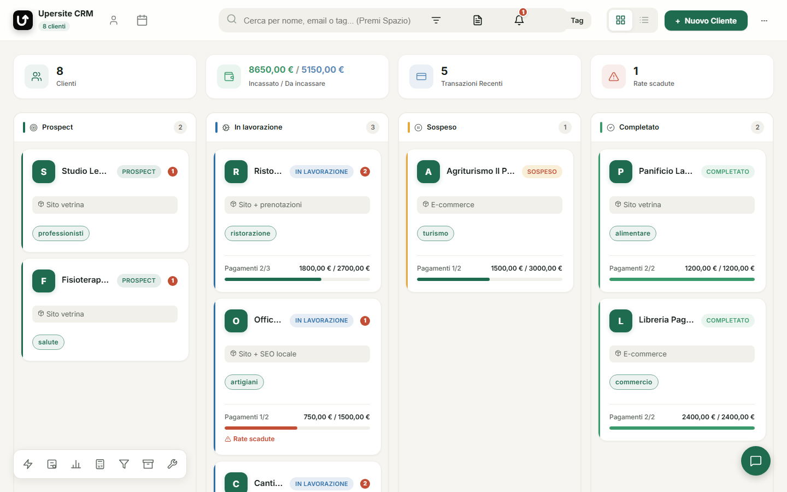
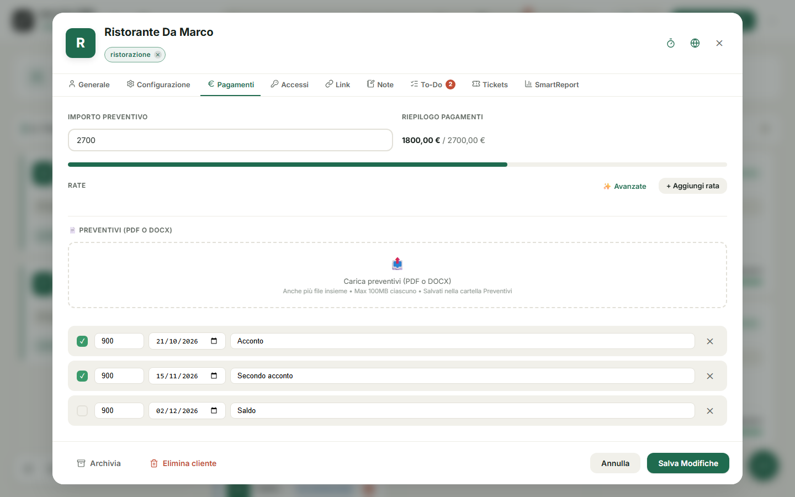
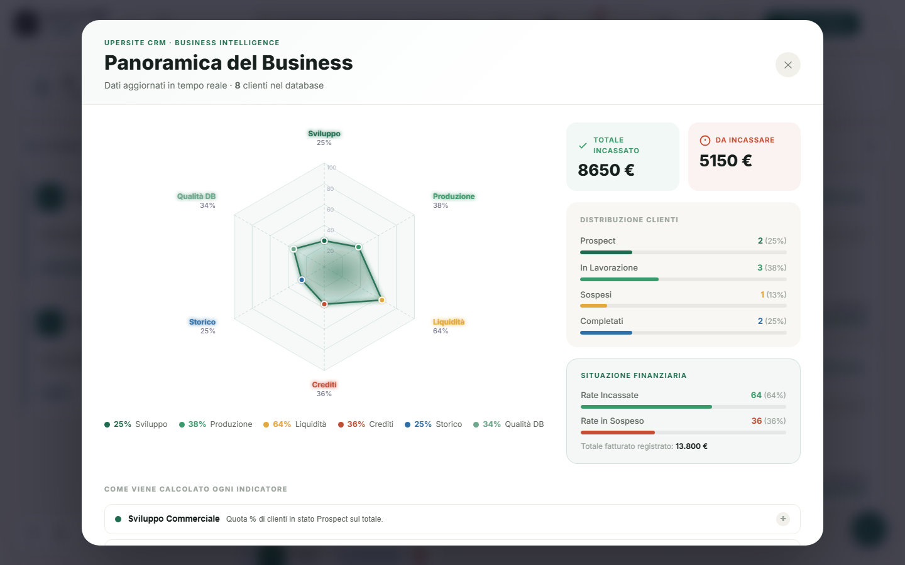
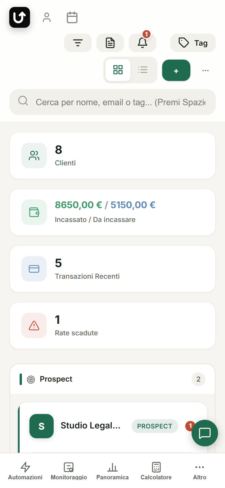
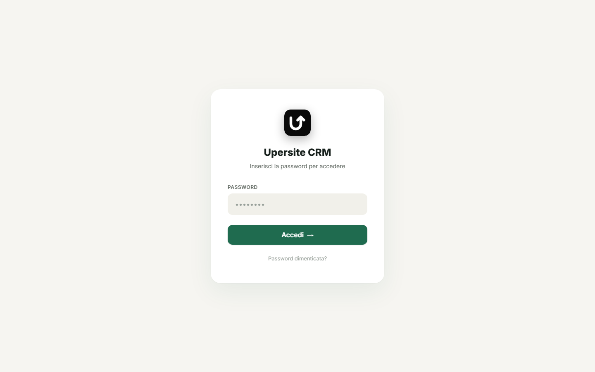

<p align="center">
  
</p>

<h1 align="center">Upersite CRM</h1>

<p align="center">
  Il CRM di Upersite Studio: clienti, preventivi, pagamenti, task, note e automazioni.<br>
  Si installa con Docker sul tuo server e si usa dal browser. I dati restano tuoi, cifrati sul tuo disco.
</p>

**Versione:** 2.0.0-stable · [Cronologia](Versioning.txt) · [Guida all'uso](Upersite%20CRM%20-%20software/Guida_UpersiteCRM.md)

<p align="center">
  
</p>

## Come si presenta

<table>
  <tr>
    <td width="50%"><br><sub><b>Scheda cliente</b>: pagamenti, rate, preventivi, task, note e accessi.</sub></td>
    <td width="50%"><br><sub><b>Panoramica del business</b>: incassi, crediti aperti e stato dei clienti.</sub></td>
  </tr>
  <tr>
    <td width="50%" align="center"><br><sub><b>Da telefono</b>: stessa app, con la navigazione in basso.</sub></td>
    <td width="50%" align="center"><br><sub><b>Accesso</b>: password master verificata dal server.</sub></td>
  </tr>
</table>

<sub>Le immagini mostrano dati inventati.</sub>

## Cosa fa

- **Clienti** in vista Kanban (Prospect → In lavorazione → Completato → Sospeso), lista e tabella, con tag, logo e ricerca
- **Finanza**: preventivi, rate e scadenze, transazioni recenti, dashboard con grafici e panoramica del business
- **Task** con priorità, scadenze e ricorrenza, matrice di Eisenhower e calendario
- **Note** con editor ricco e grafo in stile Obsidian
- **Ticket** per cliente e **fogli ore** con guadagno €/ora
- **Credenziali** dei clienti cifrate con la password master
- **Calcolatore preventivi** integrato, con export PDF, Word ed Excel
- **Automazioni**: editor a nodi per workflow (eventi, condizioni, azioni)
- **AI** (facoltativa): chat, report sui clienti, riassunti delle note. Servizi locali (LM Studio, Unsloth Studio) o cloud (Ollama Cloud, Google Gemini)
- **Backup** automatici e ripristino, anche di soli alcuni clienti

## Installazione con Docker

Serve solo Docker. Funziona su amd64 e arm64 (PC, Mac, Raspberry Pi, Umbrel).

```bash
git clone https://github.com/tombino104/Upersite-CRM.git
cd "Upersite-CRM/Upersite CRM - software"
```

**1. Crea la chiave di cifratura** (una volta sola) e conservala anche nel password manager: senza di lei i dati non si recuperano.

```bash
mkdir secrets
openssl rand -base64 32 > secrets/crm_encryption_key.txt
```

**2. Avvia**

```bash
docker compose up -d --build
```

**3. Apri** <http://localhost:3000> e crea la password master.

Nelle Impostazioni → Backup scrivi come cartella dei salvataggi `/backups`: è la cartella `backups/` accanto al `docker-compose.yml`.

### Cartelle e volumi

| Nel container | Sul computer | Contiene |
|---|---|---|
| `/data` | `./data` | `crm_data.json`, preventivi, calcolatore, chiavi AI |
| `/backups` | `./backups` | backup con data |

Dati, backup e chiavi non finiscono mai nell'immagine né su git.

### Impostazioni (variabili d'ambiente)

| Variabile | Default | A cosa serve |
|---|---|---|
| `CRM_ENCRYPTION_KEY` / `CRM_ENCRYPTION_KEY_FILE` | – | Chiave di cifratura (direttamente o da file, es. secret di Docker). Senza chiave i file restano in chiaro e il server lo scrive nel log |
| `CRM_DATA_DIR` | `/data` | Cartella dei dati |
| `PORT` / `HOST` | `3000` / `0.0.0.0` | Porta e indirizzo del server |
| `CRM_SESSION_HOURS` | `12` | Ore di inattività dopo cui la sessione scade |
| `CRM_TRUST_PROXY` | `0` | Mettilo a `1` dietro Tailscale o Cloudflare Tunnel, così il blocco dopo i tentativi sbagliati vale per chi prova davvero |
| `AI_ENV_FILE` | `<dati>/.env.local` | File con le chiavi dei servizi AI |

### Aggiornare

```bash
git pull
docker compose up -d --build
```

I dati stanno nei volumi, quindi non si perdono. Se il server non parte dopo un aggiornamento, guarda `docker compose logs`.

### Accesso da fuori casa

Per sicurezza la porta è aperta solo su `127.0.0.1`. Per usare il CRM da altri dispositivi metti davanti **Tailscale Serve** o un **Cloudflare Tunnel** (HTTPS) e imposta `CRM_TRUST_PROXY=1`. Non aprire la porta direttamente su internet.

### Umbrel

L'immagine è pubblicata su GitHub Container Registry per amd64 e arm64:

```
ghcr.io/tombino104/upersite-crm:<versione>
```

Nel `docker-compose.yml` di un'app Umbrel mappa `/data` e `/backups` su cartelle dell'app e passa `CRM_ENCRYPTION_KEY`.

## Sicurezza

- **Login sul server:** ogni richiesta alle API richiede una sessione (cookie `HttpOnly`, `SameSite=Strict`, `Secure` in HTTPS). Dopo 5 password sbagliate il server blocca i tentativi, con attese sempre più lunghe.
- **Cifratura a riposo:** `crm_data.json`, le sue copie nei backup e i preventivi sono cifrati con AES-256-GCM. La chiave la dai tu e non sta nel codice né nei dati. Se la chiave manca o è sbagliata il server non parte, senza rovinare i dati.
- **Credenziali dei clienti:** cifrate anche con la password master (AES-GCM, chiave da PBKDF2), quindi restano illeggibili anche a chi ha la chiave del server.
- **Segreti:** le chiavi dei servizi AI restano sul server (`.env.local`), il browser parla solo con `/api/ai/*`. Il file `.env.local` e il calcolatore non sono cifrati.
- Le note e le risposte dell'AI vengono ripulite con DOMPurify. Le richieste che modificano i dati richiedono un header interno e rifiutano le richieste cross-site.

**Non sono cifrati:** i backup creati prima di attivare la cifratura (restano in chiaro dove sono), le configurazioni del calcolatore e `.env.local`.

### Password master dimenticata

Dal computer dove gira il server:

```bash
docker exec upersite-crm node server/reset-password.js
```

Poi apri subito il CRM e creane una nuova. I dati dei clienti restano; le password della sezione Accessi sono cifrate con la vecchia password master e tornano leggibili solo reimpostando la stessa di prima. Il file precedente viene copiato accanto all'originale.

## Sviluppo

Servono [Node.js](https://nodejs.org) 20.19 o superiore e `npm install`.

```bash
cd "Upersite CRM - software"
npm install
npm run dev          # sviluppo, su http://localhost:5173
npm run build        # compila l'app in dist/
npm start            # server di produzione (serve dist/ e le API) su http://localhost:3000
npm run reset-password
```

Con `npm run dev` e `npm start` i dati stanno nella cartella del programma (`crm_data.json`, `Dati/`, `.env.local`), a meno di impostare `CRM_DATA_DIR`. Sono tutti esclusi da git.

```
Upersite CRM - software/
├── src/                  # app React (App.jsx, components/, hooks/, utils/)
├── server/
│   ├── index.js          # server di produzione: serve dist/ e le API
│   ├── api.js            # le API (dati, backup, preventivi, calcolatore, AI)
│   ├── auth.js           # login e sessioni
│   ├── vault.js          # cifratura a riposo
│   ├── aiProxy.js        # ponte verso i servizi AI
│   └── reset-password.js
├── public/               # logo, calcolatore preventivi
├── Dockerfile
└── docker-compose.yml
```

Stack: React 19, Vite 7, Node.js (solo moduli integrati nel server), Recharts, React Flow, jsPDF.

## Versioni e rilasci

Formato `Major.Minor.Patch-stato` (`alpha`, `beta`, `stable`). Quando cambi versione aggiorna **tre file** con lo stesso numero: `Upersite CRM - software/package.json`, `Upersite CRM - software/src/utils/version.js` e `Versioning.txt`.

Per pubblicare l'immagine Docker:

```bash
git tag v2.0.0-stable
git push origin v2.0.0-stable
```

Il workflow `.github/workflows/docker-image.yml` costruisce l'immagine per amd64 e arm64 e la pubblica su `ghcr.io/tombino104/upersite-crm` con i tag `v2.0.0-stable`, `2.0.0-stable` e `latest`. Dopo la prima pubblicazione controlla su GitHub (Packages) che il pacchetto sia pubblico.
